## Before we start

Let's check if we are all set with the [teams](https://docs.google.com/spreadsheets/d/1tNwDnfKM84gI-Xd5myr4gbRRJeRGBvAuAr4YjOy-M-o/edit#gid=0).

## Recap

:::{.columns}

:::{.column width="70%"}

Basic Git workflow:

:::{.nonincremental}

1. **Initialize** a Git repository
2. **Work** on the project
3. **Stage** and **commit** changes to the local repository
4. **Push** to the remote repository

:::

:::

:::{.column width="30%"}

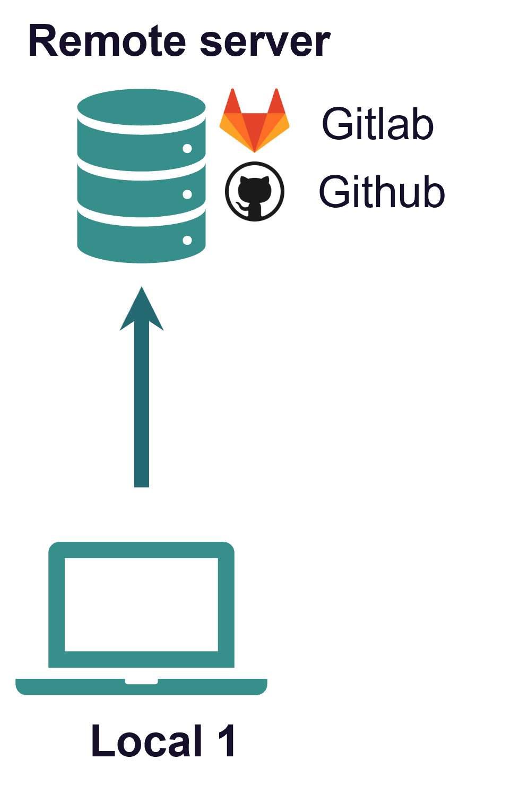{fig-align="center"}

:::

:::


## Recap

:::{.columns}

:::{.column width="70%"}

Basic Git workflow:

:::{.nonincremental}

1. **Initialize** a Git repository
2. **Work** on the project
3. **Stage** and **commit** changes to the local repository
4. **Push** to the remote repository

:::

:::

:::{.column width="30%"}

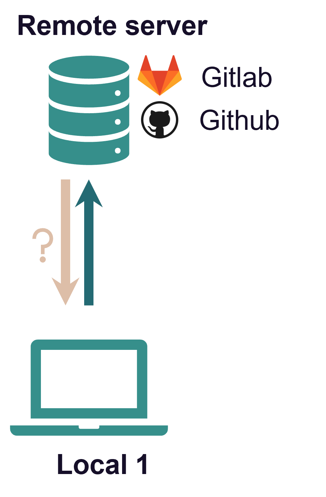{fig-align="center"}

:::

:::

## Recap

Git is a **distributed version control system**

:::{.columns}

:::{.column width="50%"}

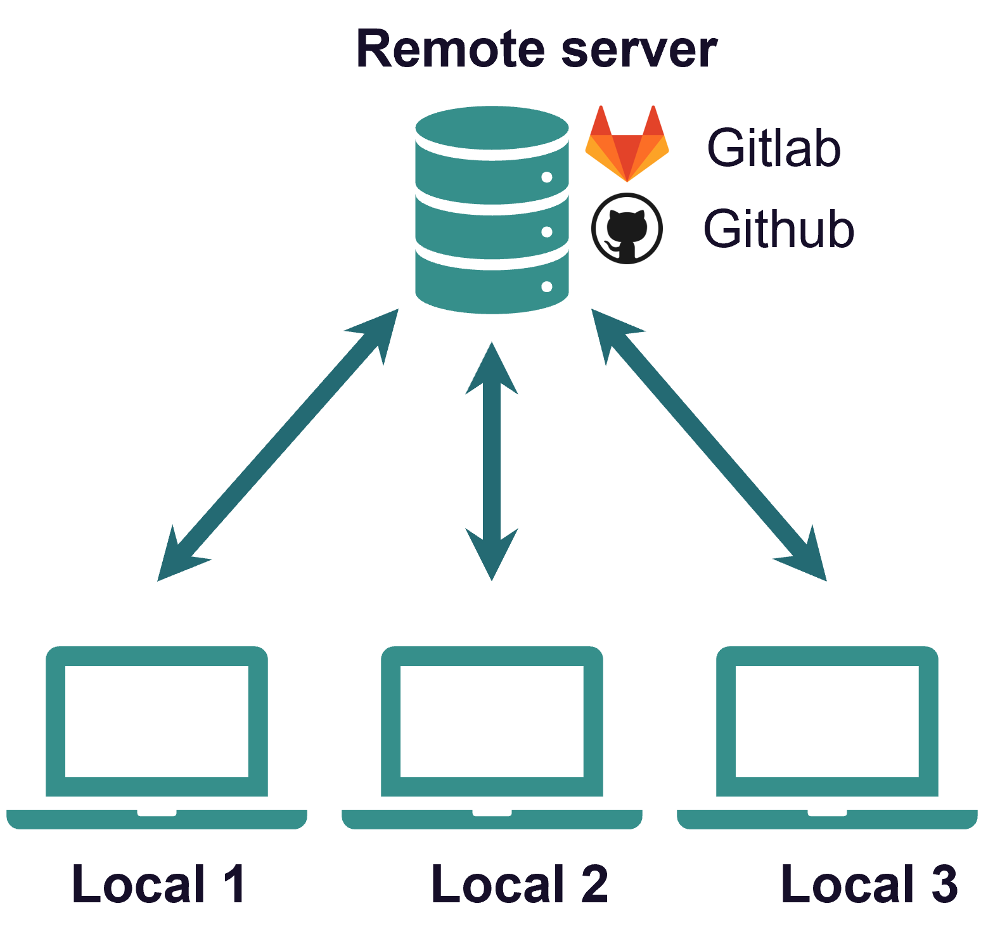

:::

:::{.column width="50%"}

::: {.nonincremental}

- Idea: many *local* repositories synced via one *remote* repo

:::

::: {.nonincremental}
- Collaborate with
  - **yourself** on different machines
  - your **colleagues** and friends
  - **strangers** on open source projects

:::

:::

:::

## Get a repo from a remote

In Git language, this is called **cloning**

:::{.nonincremental}
  - Get a **full copy** of the remote repo
:::

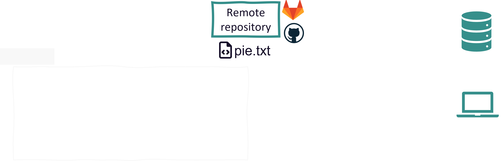

## Get a repo from a remote

In Git language, this is called **cloning**

:::{.nonincremental}
  - Get a **full copy** of the remote repo
:::

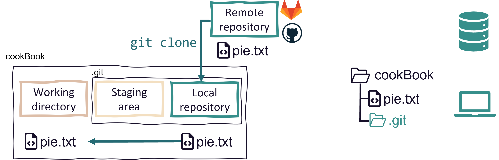

## Get a repo from a remote

You can clone

- all of your own repositories (public and private)
- all repositories you are a collaborator on (public and private)
- all public repositories of other people

. . .

All you need is the URL of the remote repository

::: {.fragment}

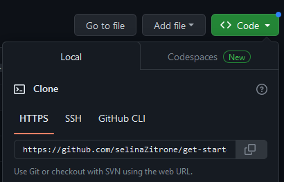

:::

# Now you (5 min) {.task-slide}

> Clone your team mate's cook book repo<br>
> Details in [Task 1 "Clone"](https://selinazitrone.github.io/get-started-with-git/sessions/02_git_collaboration.html#tasks)

## Get changes from the remote

::: {.nonincremental}

- Local changes, publish to remote: `git push`
- Remote changes, pull to local: `git pull`

:::

. . .

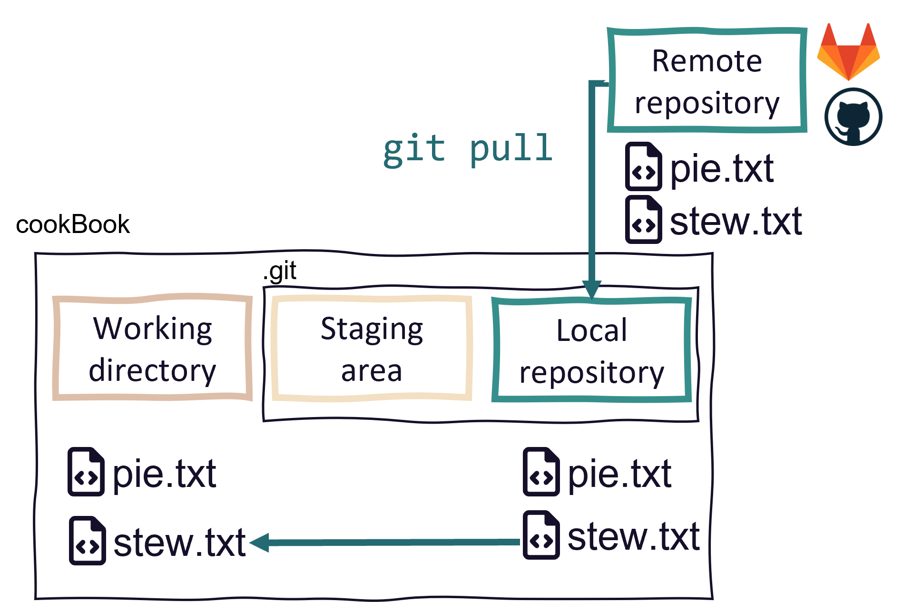{width=63% fig-align="center"}

## A simple collaboration workflow

<br>

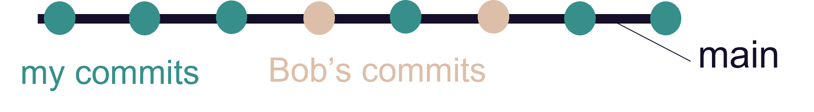

::: {.nonincremental}

- One remote repo on GitHub, multiple local repos (Bob and me)

:::

- Idea: Everyone works on the same branch
  - **Pull before** you start **working**
  - **Push after** you finished **working**
  
## A simple collaboration workflow

<br>


This works well if

- Repo is not updated often
- You don't work on the same files simultaneously
- No need to discuss changes before they are integrated
- You collaborate with yourself

## Let's give it a try

. . .

::: {.nonincremental}

- Make sure you are in the repository of your team mate
- Open a recipe in the cook book of your team mate
  - **Repository -> Show in Explorer/Finder**
- Change something in there
- Commit the change and push it

:::

. . .

::: {.nonincremental}

Get the changes of your team mate from the remote.

- Switch to your own cook book repository
- Pull the changes (Same button as the push button)
- Have a look at the commit history to see what changed

:::

## A simple collaboration workflow

<br>


This workflow starts to be problematic when

- People push often/forget to pull regularly
  - Potential conflicts on main
- You just want to experiment
  - Everything goes directly to main
  


## A branching-merging workflow

<br>

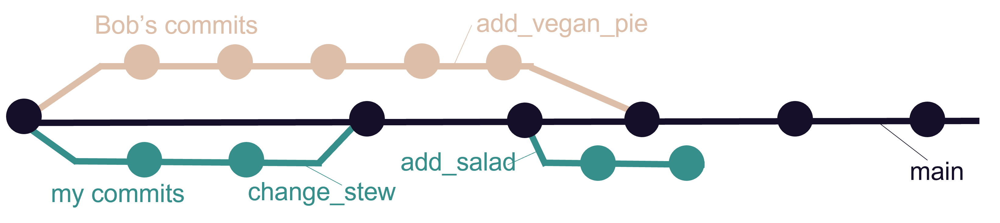

- One remote repo on GitHub, multiple local repos
- Idea: Everyone works on their **separate branch**
  - **Merge** branch with the main when work is done
- **Pull before** and **push after** working

## A branching-merging workflow

<br>


**Advantages** of this approach

- Guarantee that main always works
- Potential conflicts don't have to be solved on main
- You can experiment without messing up the main

## Working on a separate branch

The steps to create and work on a separate branch are easy:

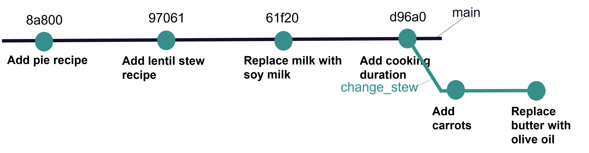

- Create a local branch and switch to it
- Work on the branch like you are used to
  - Make changes, **stage** and **commit**

## Merging changes from a branch

To bring changes to the main branch you need to **merge** them.

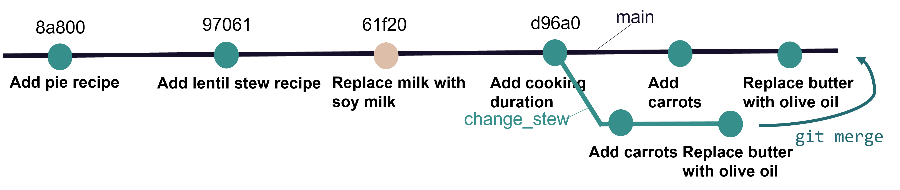

Git merge brings the commits from the branch to main

## Merging changes from a branch

To bring changes to the main branch you need to **merge** them.

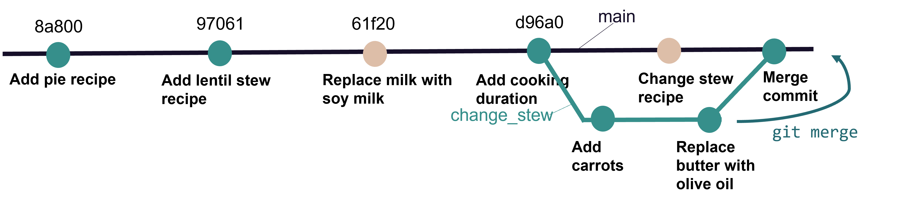

If there was a commit in main, a *merge commit* is introduced.

# Now you (10 min) {.task-slide}
> [Create a branch and merge it in your team mate's cook book](https://selinazitrone.github.io/get-started-with-git/sessions/02_git_collaboration.html#tasks)<br>
> Complete task 2 "Branch and merge"

## A branching-merging workflow with GitHub

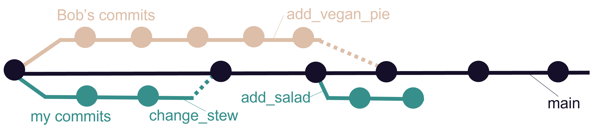

- One remote repo on GitHub, multiple local repos
- Idea: Everyone works on their separate branch
  - ~~**Merge** branch with the main when work is done~~

## A branching-merging workflow with GitHub

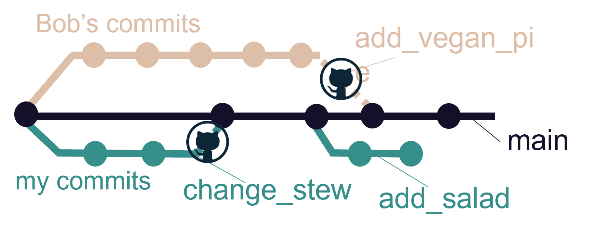

::: {.nonincremental}

- One remote repo on GitHub, multiple local repos
- Idea: Everyone works on their separate branch
  - ~~**Merge** branch with the main when work is done~~
  - **Create a pull request** on GitHub to ask for a merge

:::

- **Pull before** and **push after** working

## A branching-merging workflow with GitHub

A pull request is basically asking your collaborators:

> What do you think of my changes? Can we integrate them in main or do we still need to change something?

. . .

GitHub has nice features for pull requests, e.g.:

- **Provide context and explanations** for your changes
- Collaborators can easily **compare versions**
- Collaborators can **discuss and comment** on your changes

. . .

A pull request is merged on GitHub when **everyone agreed on the code**.

# Now you (10 min) {.task-slide}
> [Create a pull request on your team mate's repo](https://selinazitrone.github.io/get-started-with-git/sessions/02_git_collaboration.html#tasks)<br>
> Complete task 3 "Pull requests"

# Some good practice tips {.inverse}

## Git

- Commit often (small changes that can be described in one commit message)
- Write good commit messages (it becomes a habit)
- Push (at least) daily (backup!)
- Use `.gitignore`
- Don't commit secrets ;)

## Publishing

Some essentials that will improve your published repository:

- Add a good README.md file
  - Tell people what your project is about and how to use it
  - Check out the [GitHub documentation](https://docs.github.com/en/get-started/writing-on-github/getting-started-with-writing-and-formatting-on-github/basic-writing-and-formatting-syntax) for formatting options
- Add a LICENSE file
  - Tell others how to use your code
- Add a DOI to your repository (e.g. via [Zenodo](https://emilio-berti.github.io/idiv-git-introduction/21-github_zenodo/index.html))

. . . 

If you are interested, browse some nice GitHub repositories for inspiration (e.g.
[Computational notebooks guide](https://github.com/FellowsFreiesWissen/computational_notebooks))

## What now?

- Git can seem complicated at first, but you will get used to it
- Make it a habit to use Git, start with your own projects
- Improve your workflow step by step
- Practice makes perfect

Check out the [resources page](https://selinazitrone.github.io/get-started-with-git/resources.html) and the different How-tos for more info and practice.

# Thanks for your attention

> Questions?

# Appendix: Merge conflicts {.inverse}

## Merge conflicts

](img/day3/merge_conflicts.png){fig-alt="Cartoon of the GitHub octocat mascot hugging a very sad looking little furry monster while the monster points accusingly at an open laptop with \"MERGE CONFLICT\" in red across the entire screen. The laptop has angry eyes and claws and a wicked smile. In text across the top reads \"gitHUG\" with a small heart." width=75%}

## When do conflicts happen?

- Two changes to the **same lines of the same file**
  - e.g. on two branches that you want to merge
  - or in your local and the remote repo when you pull
- Git cannot decide which version to keep, so it **asks you**
- Nothing is lost and you can always abort the merge

## What a conflict looks like

Git marks the conflicting lines in the file:

```md
1 tsp vanilla extract
<<<<<<< HEAD
1 tbsp honey
=======
3 tbsp sugar
>>>>>>> more-sugar
Pinch of salt
```

- Between `<<<<<<< HEAD` and `=======`: version on your current branch (main)
- Between `=======` and `>>>>>>> more-sugar`: version on the branch you merge

## Editors can help

Many editors highlight conflicts and let you choose a version with one click, e.g. VS Code:

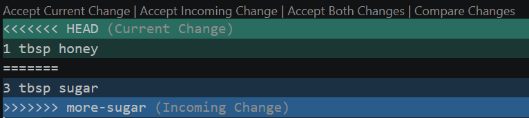{width=80% fig-alt="Conflict in VS Code: the current change 1 tbsp honey and the incoming change 3 tbsp sugar are highlighted in different colors, with the options Accept Current Change, Accept Incoming Change, Accept Both Changes and Compare Changes above them"}

## Resolve conflicts in GitHub Desktop

GitHub Desktop warns you before the merge

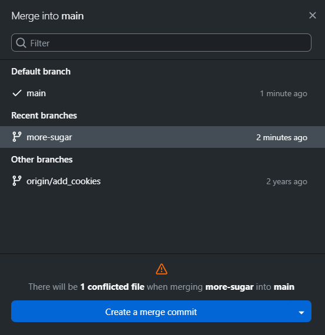{width=45% fig-alt="GitHub Desktop dialog Merge into main with the branch more-sugar selected and the warning: There will be 1 conflicted file when merging more-sugar into main"}

## Resolve conflicts in GitHub Desktop

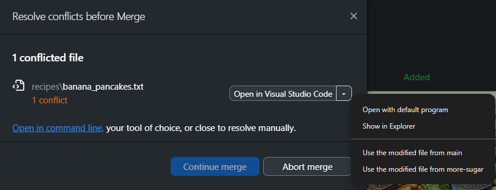{width=70% fig-alt="GitHub Desktop dialog Resolve conflicts before Merge listing the conflicted file banana_pancakes.txt, with the open dropdown offering to use the modified file from main or from more-sugar"}

::: {.nonincremental}

1. Open the file in your editor, keep what you want (or combine both) and **delete the markers**
2. Or use the dropdown to keep the whole file from one branch

:::

## Resolve conflicts in GitHub Desktop

When all conflicts are resolved, finish the merge with **Continue merge** (or go back with **Abort merge**)

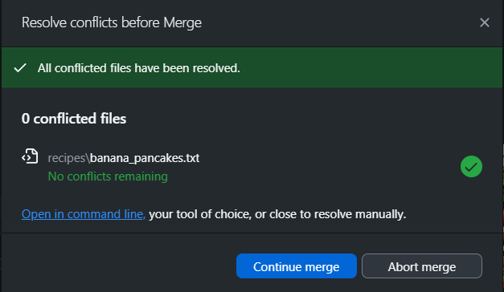{width=55% fig-alt="GitHub Desktop dialog showing that all conflicted files have been resolved, with the buttons Continue merge and Abort merge"}

## Resolve conflicts in the terminal

::: {.nonincremental}

- `git merge more-sugar` reports the conflict
- `git status` shows the conflicted files
- Open the file, keep what you want and delete the markers
- `git add <file>` and `git commit` to finish the merge
- Or go back with `git merge --abort`

:::

## How to avoid conflicts

- **Pull before** you start working
- **Commit and push often** (small changes)
- Keep branches **short-lived** and merge them regularly
- **Talk to your collaborators**: Who works on which file?
